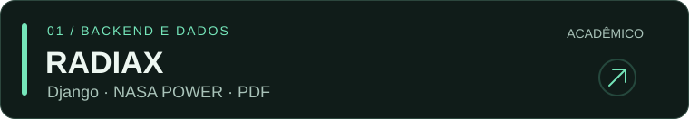
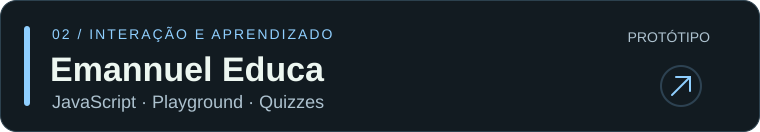
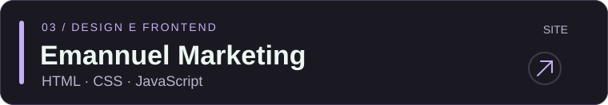

  

  
  
  

## Sobre mim

Sou **Emannuel Márdyan**, desenvolvedor full stack e estudante de **Engenharia de Software**. Construo aplicações web, sistemas de gestão e interfaces que conectam necessidades reais a uma operação simples de usar.

Estudo **cibersegurança**, com interesse em segurança de aplicações e no desenvolvimento de software confiável. Meu foco é entender como um sistema funciona, como pode falhar e como melhorar suas decisões de arquitetura, acesso e tratamento de dados.

Este perfil reúne projetos de clientes, aplicações de estudo e protótipos. A documentação de cada repositório informa o escopo, a forma de execução e as limitações conhecidas.

## Áreas de atuação e estudo

| Frente | Foco |
|---|---|
| **Desenvolvimento full stack** | Interfaces responsivas, backend, integrações e persistência de dados. |
| **Engenharia de Software** | Requisitos, modelagem, organização do código, testes e evolução de aplicações. |
| **Cibersegurança** | Estudos de autenticação, autorização, validação de entradas e proteção de dados em aplicações web. |

## Tecnologias

**Backend e dados**

**Frontend**

**Ferramentas de desenvolvimento**

## Projetos selecionados

Estudo de dimensionamento solar, consulta de irradiação, análise de geração e propostas em PDF. A aplicação usa a identidade **RADIAX**; o repositório mantém o identificador `solvian`. O README apresenta as limitações acadêmicas e de execução.

[Explorar código e documentação →](https://github.com/iamnothuman7/solvian)

Protótipo de ensino de programação com lições, playground, quizzes e conquistas. Contas e progresso ficam no navegador; o assistente usa respostas predefinidas.

[Explorar código e documentação →](https://github.com/iamnothuman7/emannuel-educa)

Site de apresentação profissional, com navegação mobile, animações e identidade visual própria. Um trabalho de interface e comunicação visual.

[Explorar código e documentação →](https://github.com/iamnothuman7/emannuel.mkt)

## Mais projetos

O **[mapa do portfólio](./PORTFOLIO.md)** organiza os repositórios por finalidade:

- Aplicações e estudos de backend.
- Sistemas de gestão para clientes.
- Sites, interfaces e experiências no navegador.
- Protótipos e versões relacionadas.

Cada projeto tem um papel diferente. Um protótipo, uma base derivada de um starter e um sistema de cliente são identificados como tal.

## Vamos conversar

Desenvolvimento de sistemas, interfaces e integrações.

**[Veja o portfólio](./PORTFOLIO.md) · [LinkedIn](https://www.linkedin.com/in/emannuelmardyan7/) · [Instagram](https://www.instagram.com/emannuel.dev/)**
